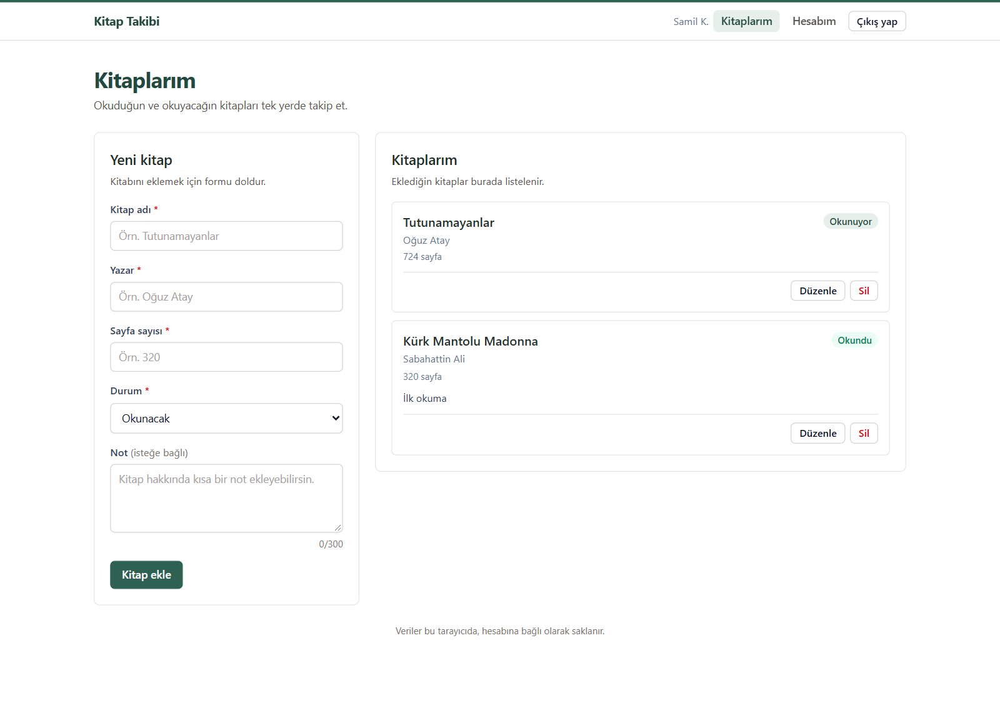

# Kitap Takibi

Okuduğun ve okuyacağın kitapları tek yerde takip etmek için geliştirilmiş, tarayıcıda çalışan bir CRUD uygulaması.

## Proje Hakkında

Kitap Takibi; kitap adı, yazar, sayfa sayısı, okuma durumu ve isteğe bağlı bir notla kayıt oluşturmanı sağlar. Uygulama yerel hesaplarla çalışır: her hesabın kitap listesi ayrı tutulur ve sayfa yenilendiğinde korunur. Veriler tarayıcının LocalStorage alanında saklanır; backend veya veritabanı kullanılmaz.

## Özellikler

- Yerel hesap oluşturma, giriş ve çıkış
- Kullanıcı bazlı kitap listesi (hesaplar arası veri izolasyonu)
- Hash tabanlı sayfa yönlendirme ve oturum koruması
- Kitap ekleme
- Sayfa sayısı bilgisi
- Kitapları listeleme
- Kitap bilgilerini düzenleme
- Onaylı kitap silme
- Zorunlu alan ve karakter sınırı doğrulaması
- Boş liste durumu
- İşlem sonucu bildirimleri
- Hesabım sayfasında kişisel okuma özeti
- Görünen ad güncelleme
- Mevcut şifreyi doğrulayarak şifre değiştirme
- LocalStorage ile veri kalıcılığı
- Farklı ekran genişliklerine uyumlu arayüz

## Teknolojiler

- React 19
- Vite 8
- Tailwind CSS 4
- LocalStorage
- Web Crypto API (PBKDF2-SHA256)

## Proje Yapısı

```text
src/
├─ components/   # Header, BookForm, BookList ve ortak form sınıfları
├─ hooks/        # Hash tabanlı yönlendirme
├─ pages/        # Giriş, kayıt, hesap ve kitap sayfaları
├─ interfaces/   # Kitap modeli, durum sabitleri ve doğrulama
├─ utils/        # Hesap, oturum ve kitap depolama katmanı
├─ App.jsx
└─ main.jsx
```

Bileşenler `components`, sayfa düzeni `pages`, veri sözleşmeleri `interfaces`, hesap ve depolama mantığı `utils` klasöründe toplanmıştır.

## Sayfalar

- `#/giris` — E-posta ve şifreyle giriş
- `#/kayit` — Yeni yerel hesap oluşturma
- `#/kitaplar` — Kitap listesi ve CRUD formu (oturum gerekir)
- `#/hesabim` — Profil, okuma özeti, ad ve şifre güncelleme (oturum gerekir)

Oturum yokken korumalı sayfalar `#/giris` adresine, oturum varken giriş/kayıt sayfaları `#/kitaplar` adresine yönlendirilir.

## Veri Saklama

- Hesaplar `kitap-takibi.accounts.v1` anahtarında JSON olarak tutulur.
- Oturum bilgisi `kitap-takibi.session.v1` anahtarında yalnızca hesap kimliğini içerir.
- Her hesabın kitapları `kitap-takibi.books.v1.<hesap-id>` anahtarında ayrı saklanır.
- Şifreler düz metin olarak tutulmaz; rastgele salt ile PBKDF2-SHA256 (150.000 iterasyon) kullanılarak özetlenir.
- Daha önce tek kullanıcılı sürümle eklenmiş kayıtlar, ilk hesap oluşturulduğunda bu hesaba taşınır.

Harici API, backend veya veritabanı kullanılmaz. Bu yöntem proje yönergesinde izin verilen bir yaklaşımdır; veriler yalnızca aynı tarayıcıda bulunur.

## Kurulum

```bash
npm install
npm run dev
```

Geliştirme sunucusu varsayılan olarak `http://localhost:5173` adresinde açılır.

Üretim derlemesi:

```bash
npm run build
npm run preview
```

## Canlı Demo

https://samil07kocakavuk.github.io/kitap-takibi/

Uygulama GitHub Pages üzerinde yayımlanmıştır.

## GitHub Deposu

https://github.com/samil07kocakavuk/kitap-takibi

## Ekran Görüntüsü



Ekran görüntüsündeki hesap ve kayıtlar tanıtım amaçlıdır; uygulama ilk açılışta hesap oluşturma ekranıyla başlar.

## Kısıtlamalar

- Hesaplar ve veriler yalnızca kullanıldığı tarayıcının LocalStorage alanında saklanır.
- Bu yerel hesap sistemi gerçek bir sunucu kimlik doğrulaması değildir; cihaza erişimi olan biri tarayıcı verilerini değiştirebilir.
- Farklı tarayıcı veya cihazlar arasında veri eşitlemesi yapılmaz.
- Tarayıcı verileri temizlenirse hesaplar ve kitap kayıtları silinir.
- Proje kapsamında backend ve veritabanı bulunmaz.
