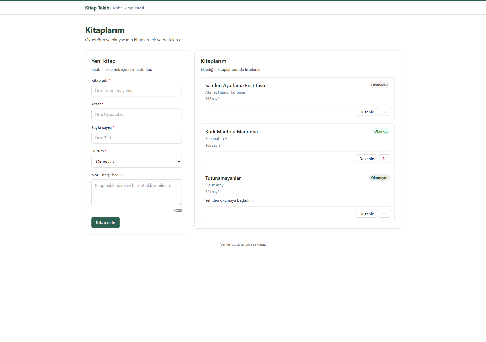

# Kitap Takibi

Kitap Takibi, okuduğun ve okuyacağın kitapları takip etmek için geliştirilmiş bir React uygulamasıdır. Uygulama açıldığında doğrudan kitap listesi gelir. Kitaplar eklenebilir, listelenebilir, düzenlenebilir ve silinebilir. Veriler tarayıcının LocalStorage alanında saklanır; backend veya veritabanı kullanılmaz.

## Özellikler

- Kitap ekleme, listeleme, düzenleme ve silme
- Okuma durumu, sayfa sayısı ve not alanları
- Form doğrulama ve anlaşılır hata mesajları
- Onaylı kitap silme ve boş liste durumu
- LocalStorage ile veri kalıcılığı
- Masaüstü ve mobil uyumlu arayüz

## Teknolojiler

- React 19
- Vite 8
- Tailwind CSS 4
- LocalStorage

## Kurulum

```bash
npm install
```

## Çalıştırma

```bash
npm run dev
```

Geliştirme sunucusu varsayılan olarak `http://localhost:5173` adresinde açılır.

Üretim derlemesi:

```bash
npm run build
npm run preview
```

## Canlı Demo

https://kitap-takibi-samil.netlify.app/

Uygulama Netlify üzerinde yayımlanmıştır.

## Kullanım

Uygulama açıldığında kitap ekleme formu ve kitap listesi doğrudan görüntülenir. Yeni kitap eklemek için formu doldurup "Kitap ekle" düğmesine basabilirsin. Listelenen kitapları "Düzenle" ile güncelleyebilir, "Sil" ile onay vererek kaldırabilirsin. Veriler aynı tarayıcıda saklanır; sayfa yenilendiğinde korunur.

## Proje Yapısı

```text
src/
  components/   form, liste ve başlık bileşenleri
  pages/        kitap sayfası
  interfaces/   kitap modeli ve durum sabitleri
  utils/        kitap depolama işlemleri
  App.jsx
  main.jsx
```

## Veri Saklama

Kitaplar LocalStorage'da tutulur. Veriler yalnızca kullanılan tarayıcıda bulunur; farklı cihazlarla eşitlenmez.

## Ekran Görüntüsü



## GitHub Deposu

https://github.com/samil07kocakavuk/kitap-takibi

## Notlar

- Tarayıcı verileri temizlenirse kitaplar silinir.
- Veriler farklı cihazlar arasında otomatik olarak eşitlenmez.
- Proje kapsamında backend ve veritabanı bulunmaz.
