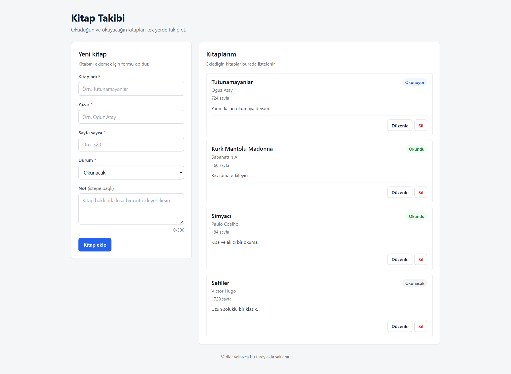

# Kitap Takibi

Kitap Takibi, kitapların okuma durumunu takip etmek için geliştirilmiş bir React uygulamasıdır. Kitaplar eklenebilir, listelenebilir, düzenlenebilir ve silinebilir. Veriler tarayıcının LocalStorage alanında saklanır; backend veya veritabanı kullanılmaz.

Uygulama yerel hesaplarla çalışır. İlk açılışta giriş ekranı gelir; hesap oluşturma bağlantısı bu ekrandan açılır. Giriş yaptıktan sonra kitap listesine erişilir.

## Özellikler

- Yerel hesap oluşturma, giriş ve çıkış
- Kitap ekleme, listeleme, düzenleme ve silme
- Okuma durumu, sayfa sayısı ve not alanları
- Hesap bazlı kitap listesi
- LocalStorage ile veri kalıcılığı
- Masaüstü ve mobil uyumlu arayüz
- Hesabım sayfasında ad ve şifre güncelleme, okuma özeti

## Teknolojiler

- React 19
- Vite 8
- Tailwind CSS 4
- LocalStorage

## Kurulum

```bash
npm install
```

## Çalıştırma

```bash
npm run dev
```

Geliştirme sunucusu varsayılan olarak `http://localhost:5173` adresinde açılır.

Üretim derlemesi:

```bash
npm run build
npm run preview
```

## Canlı Demo

https://kitap-takibi-samil.netlify.app/

Uygulama Netlify üzerinde yayımlanmıştır.

## Kullanım

İlk açılışta giriş ekranı gelir. "Hesap oluştur" bağlantısıyla yeni hesap açılır; giriş yaptıktan sonra kitap ekleme, düzenleme ve silme işlemleri yapılabilir. Veriler aynı tarayıcıda saklanır; sayfa yenilendiğinde korunur.

## Proje Yapısı

```text
src/
  components/   ortak arayüz bileşenleri
  hooks/        sayfa yönlendirme
  pages/        giriş, kayıt, hesap ve kitap sayfaları
  interfaces/   kitap modeli ve durum sabitleri
  utils/        hesap ve kitap depolama işlemleri
  App.jsx
  main.jsx
```

## Veri Saklama

Hesaplar, oturum bilgisi ve kitaplar LocalStorage'da tutulur. Şifreler düz metin olarak saklanmaz. Veriler yalnızca kullanılan tarayıcıda bulunur; farklı cihazlarla eşitlenmez.

## Ekran Görüntüsü



Ekran görüntüsündeki hesap ve kayıtlar tanıtım amaçlıdır.

## GitHub Deposu

https://github.com/samil07kocakavuk/kitap-takibi

## Notlar

- Tarayıcı verileri temizlenirse hesaplar ve kitaplar silinir.
- Yerel hesap sistemi gerçek bir sunucu kimlik doğrulaması değildir.
- Proje kapsamında backend ve veritabanı bulunmaz.
